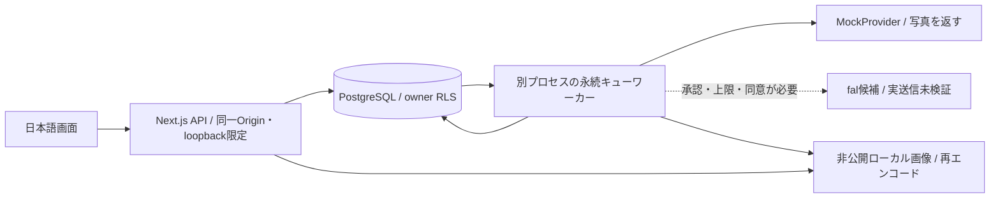

# Phase Aの構成

## 採用したもの

空のリポジトリに仕様書どおり Next.js App Router 16.4.0 / React 19.3.0 / TypeScript 7.0.2 / Tailwind 4.3.3 / Zod 4.6.5 を導入。Node 24.19.0でビルド/試験。バージョンはpackage-lockで固定。PoCは1人の運営者がローカルで使う。認証・ホスティング・有料契約は導入しない。

PostgreSQL 17 Dockerコンテナは127.0.0.1:55432のみ。DB volumeはWebプロセス停止に耐える。DB接続はNOSUPERUSER/NOBYPASSRLSの `poc_app`、サーバー専用 `poc_server` ロールを継承し、トランザクション内の所有者UUIDでRLSを適用。API/workerが同一固定運営者UUIDを使う。**ブラウザ認証の代用にはならない**。Host/Originチェックとloopback bindは公開アクセスを拒否する補助であり、同じPCを使う他人を分離するサービスではない。

画像はDBにURLを保存せずUUIDパスを保存。JPEGへ再エンコードしEXIF除去、25MP/10MB/2048pxで制限。公開ディレクトリに置かない。APIが所有権を確認して返す。ジョブは入力画像ID・カテゴリ・順番のスナップショットを保存。元画像の変更は生成済み履歴に影響しない。

## 非同期・費用の整合性

受付はDBトランザクションで冪等/所有権/停止/制約/予算と件数を確認し、ジョブと最大円見積を予約して202を返す。単一PoC運営者の受付をadvisory lockで直列化する。同じキー・同じ入力は既存ジョブ、異なる入力は409。費用は最大見積の保留分を含める。

HTTP終了後のWebプロセス内タスクは使わない。専用workerはDBリースと行ロックで1ジョブを取得し、送信開始を永続化してから外部POSTを1回だけ行う。保存前クラッシュ/応答喪失は `reconciling`、IDありなら読み取り照合、IDなしは運営者確認。クライアントの自動再送は冪等。プロバイダー内部再実行の制御/課金条件は外部契約に従う。

タイムアウト180秒は照合待ちへの移行であり、外部処理の終了保証ではない。API成功でも費用はunknown、請求確認まで予約を保留。失敗が課金されないと推測して解放しない。取消はqueuedのみ確定扱い。削除中の結果は保存しない。

## migration/RLSの適用範囲

`supabase/migrations/001_phase_a.sql` はPhase Aの画像、ジョブ、結果、試行、費用、評価のみ。全テーブルRLS+FORCE、通常authenticatedはSELECTのみ、サーバー以外にジョブ/費用の更新権限は与えない。Supabaseが存在するときだけprivate Storage bucketと本人prefix SELECT policyを準備する。ローカルではStorage schemaがないためその分岐は未実行。公開bucket既存設定やSupabase上のStorage/API認可は別途統合試験が必要。MVPの全17テーブルを実装済みとは扱わない。

## PoC後に決める構成

| 方式 | 実行時間・復旧 | 費用 | Phase Aの判断 |
|---|---|---|---|
| ローカルPostgreSQL+専用worker | 常駐。リース/予約/状態をDBに保持。PC停止時は停止 | 外部サービス利用料0、既存PC/電気は別 | 今回採用・モック検証可能 |
| fal永続キュー+アプリ照合worker | AIキューは外部永続。受付と外部ID保存の間の不明送信は残る | モデル従量+アプリworker基盤 | 実API候補、未実行 |
| managed durable worker + Supabase | サービス制限/再試行/秘密管理を要調査。DBが台帳 | 現行商用プラン未選定 | MVP前の運営者判断で選ぶ |
| Vercel HTTP応答後タスクだけ | プロセス継続保証が不足 | 未契約 | 採用しない |

鍵は `.env.local` /安全な環境設定だけ。EC2/Kubernetesは導入しない。PoC終了時に実品質、最大処理時間、課金、下流保持を測ったうえでMVPのworker基盤・月額・Supabase/Vercel商用条件を確定する。現在のローカル構成を本番採用確定とはしない。各クラウドタスクは既に隔離されており、既存チェックアウトを使用する。Git worktreeは作らない。
